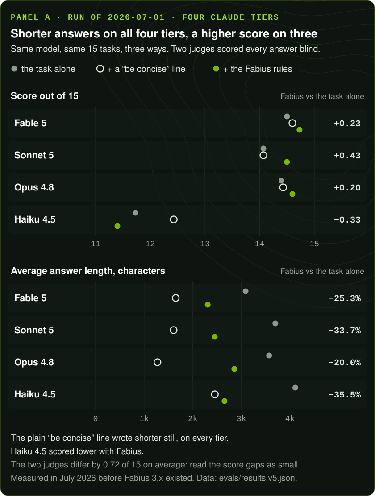

<!-- © 2026 shear559 · fabius · provenance fab1-6bbf82d118bce2cee9d7ac71f034fa26 · release evidence: PROVENANCE.md · github.com/shear559/fabius -->
<!-- fabius-release: 3.5.0 -->
# The fabius benchmark

## Public benchmarks, October 2026

The current skill files were measured on nine established public benchmarks, each against the same model, harness and tasks without Fabius, under a protocol committed and pushed before each block of runs. Scope: Fabius 3.3.0 (sealed root `e1958cb5…`; 3.4.0 changes no skill contract), `claude-sonnet-5-5`, Claude Code 2.1.289 headless in a clean context, 2026-10-06 to 2026-10-08, one sample per task (two on SWE-bench).

- **The router, `/fabius`:** no detectable difference on SWE-bench Verified Mini (88.0% vs 84.0% resolved, k = 2, n = 50) at ×1.60 the baseline's cost, a tie on IFEval (87.4% vs 89.1%, n = 540) at ×1.87, and a tie on HumanEval+ (96.3% vs 95.1%, n = 163) at ×1.98.
- **Each skill by its own command, `/fabius:fabius-<skill>`:** ties for `fabius-parcus` (HumanEval+) at ×1.61 the cost, `fabius-scientia` (LAB-Bench) at ×1.74, `fabius-fortuna` (FinQA) at ×1.96 and `fabius-cohors` (BFCL) at ×2.03; non-inferior results for `fabius-praesidium` (CyberSecEval) at ×1.69, `fabius-doctrina` (DS-1000) at ×2.02 and `fabius-catena` (SmartBugs-curated) at ×1.89; no detectable difference for `fabius-disciplina` (SWE-bench Verified Mini) at ×1.84.
- **Nothing gained or lost after correction.** The largest differences, `fabius-catena` at +4.9 points and `fabius-doctrina` at +4.0, have unadjusted 95% intervals above zero, but their Holm-adjusted p-values are 0.312 and 0.538, so neither is claimed as a gain.
- **The invocation matters.** `/fabius` loaded the router's rules in 803 of 803 runs and each skill's command loaded that skill in 1,271 of 1,271; the README's earlier `fabius:` prefix loaded the router in 1 of 186. The router loaded a specialist on its own in 1 of its 803 runs.

| Invocation | Benchmark (endpoint) | n | Fabius | Baseline | Difference (points) | 95% CI | p (Holm) | Verdict | Cost |
|---|---|---|---|---|---|---|---|---|---|
| `/fabius` | SWE-bench Verified Mini (resolved) | 50 × 2 | 88.0% | 84.0% | +4.0 | -1.0 to +10.0 | 0.867 | INCONCLUSIVE | ×1.60 |
| `/fabius` | IFEval (prompt-level strict) | 540 | 87.4% | 89.1% | -1.7 | -4.6 to +1.2 | 0.867 | TIE | ×1.87 |
| `/fabius` | HumanEval+ (plus tests pass) | 163 | 96.3% | 95.1% | +1.2 | -1.7 to +4.6 | 0.867 | TIE | ×1.98 |
| `fabius:` prefix | HumanEval+ (plus tests pass) | 163 | 96.3% | 95.1% | +1.2 | -1.2 to +4.2 | 0.500 | TIE | ×1.33 |
| `/fabius:fabius-disciplina` | SWE-bench Verified Mini (resolved) | 50 × 2 | 87.0% | 84.0% | +3.0 | -2.0 to +10.0 | 1.000 | INCONCLUSIVE | ×1.84 |
| `/fabius:fabius-parcus` | HumanEval+ (plus tests pass) | 163 | 95.1% | 95.1% | +0.0 | -2.7 to +2.7 | 1.000 | TIE | ×1.61 |
| `/fabius:fabius-praesidium` | CyberSecEval instruct, Python (not flagged insecure) | 137 | 86.9% | 82.5% | +4.4 | -0.6 to +9.7 | 0.876 | NON-INFERIOR | ×1.69 |
| `/fabius:fabius-scientia` | LAB-Bench ProtocolQA + SeqQA (correct option) | 128 | 85.2% | 85.9% | -0.8 | -4.8 to +3.1 | 1.000 | TIE | ×1.74 |
| `/fabius:fabius-fortuna` | FinQA (answer matches) | 200 | 83.5% | 85.0% | -1.5 | -4.4 to +1.3 | 1.000 | TIE | ×1.96 |
| `/fabius:fabius-doctrina` | DS-1000, no PyTorch/TensorFlow (tests pass) | 200 | 87.5% | 83.5% | +4.0 | +0.1 to +8.2 | 0.538 | NON-INFERIOR | ×2.02 |
| `/fabius:fabius-catena` | SmartBugs-curated (category matches) | 143 | 76.9% | 72.0% | +4.9 | +0.8 to +9.2 | 0.312 | NON-INFERIOR | ×1.89 |
| `/fabius:fabius-cohors` | BFCL non-live AST (official AST check) | 200 | 92.0% | 92.5% | -0.5 | -3.2 to +2.1 | 1.000 | TIE | ×2.03 |

Verdicts follow the registered rule: GAIN or LOSS at a Holm-adjusted p ≤ 0.05; otherwise TIE when the 90% interval lies inside ±5 points, NON-INFERIOR when the 95% interval's lower bound is above −5 points, and INCONCLUSIVE otherwise (SWE-bench, at n = 50, can only be GAIN, LOSS or INCONCLUSIVE). Cost is Fabius ÷ baseline per task, as Claude Code reported it.

Not measured: `fabius-archivum` and `fabius-decor` (their harnesses were built and committed, and the usage cap was reached before they ran), `fabius-mercatus`, `fabius-machina` and `fabius-ludus` (no established public benchmark with an objective score for their work that runs here), and `fabius-concilium` (it needs several model providers).

Method, every deviation, the limitations and the receipts: [the report](evals/public/2026-10-public-benchmarks/REPORT.md). The full receipts archive, with every run's event stream and every scorer's output, is attached to the GitHub Release `v3.4.0-sealed`.

### The source-fold continuation, October 2026

Release 3.4.0 adds four reference files and refines ten (no skill contract changed). A second pre-registered study measured that change: three contemporary arms — no package, the frozen 3.3.0 package and the frozen fold candidate `6fb0ab0` — on eleven public benchmarks (the nine above plus LongMemEval for `fabius-archivum` and Design2Code for `fabius-decor`), with the reference files readable by the model in every arm (`Read` confined to the run and the package). Scope: `claude-sonnet-5-5`, Claude Code 2.1.289 headless, 2026-10-11 to 2026-10-12, 6,501 invocations, 33 contrasts in one Holm family.

- **No gain and no loss in any of the 33 contrasts.** The eleven fold-versus-3.3.0 contrasts came out as nine ties and two inconclusive comparisons (SWE-bench, Design2Code), with the cost ratio between ×0.99 and ×1.02.
- **The fold never reached the model.** The invoked contract was in context in every package-arm run, but the reference files were opened in 6 of 4,328 package-arm runs — all six the same unchanged praesidium playbook — including none of the 200 agentic SWE-bench runs with full read access. Under these conditions the two packages were the same package; the fold ships as reference depth with no measured effect claimed.
- **The 3.3.0 package against no package repeated the first study's pattern:** no detectable difference on SWE-bench (84.0% vs 84.0%), ties on IFEval, HumanEval+, FinQA, DS-1000, BFCL and LongMemEval, non-inferior results on CyberSecEval (+3.0), LAB-Bench (+4.1) and SmartBugs-curated (+4.9, the same +4.9 the first study found), inconclusive on Design2Code (0.973 vs 0.967, near the scorer's ceiling), at ×1.59 to ×2.03 the cost per task. LongMemEval in the oracle setting is at ceiling for this model (97.5–98.3% in every arm).

Differences in points (Design2Code: in score units) with unadjusted 95% intervals; verdicts from the Holm-adjusted p over all 33 contrasts (every adjusted p is 1.000).

| Benchmark (endpoint) | Invocation | n | candidate − old | old − baseline | candidate − baseline |
|---|---|---|---|---|---|
| SWE-bench Verified Mini (resolved, k = 2) | `/fabius:fabius-disciplina` | 50 | +4.0 (-2.0 to +12.0) INCONCLUSIVE | +0.0 (-6.0 to +6.0) INCONCLUSIVE | +4.0 (-2.0 to +12.0) INCONCLUSIVE |
| IFEval (prompt-level strict) | `/fabius` | 539 | -2.0 (-4.4 to +0.3) TIE | -0.4 (-3.0 to +2.2) TIE | -2.4 (-5.4 to +0.5) TIE |
| HumanEval+ (plus tests pass) | `/fabius:fabius-parcus` | 163 | +0.0 (-2.7 to +2.7) TIE | -0.6 (-3.2 to +1.6) TIE | -0.6 (-3.2 to +1.6) TIE |
| CyberSecEval instruct, Python (not flagged insecure) | `/fabius:fabius-praesidium` | 200 | +0.0 (-2.4 to +2.4) TIE | +3.0 (-1.2 to +7.4) NON-INFERIOR | +3.0 (-0.7 to +7.0) NON-INFERIOR |
| LAB-Bench ProtocolQA + SeqQA (correct option) | `/fabius:fabius-scientia` | 219 | -2.3 (-5.6 to +0.8) TIE | +4.1 (+0.6 to +7.9) NON-INFERIOR | +1.8 (-2.5 to +6.2) NON-INFERIOR |
| FinQA (answer matches) | `/fabius:fabius-fortuna` | 200 | -1.5 (-3.7 to +0.5) TIE | +1.0 (-1.3 to +3.4) TIE | -0.5 (-2.6 to +1.6) TIE |
| DS-1000, no PyTorch/TensorFlow (tests pass) | `/fabius:fabius-doctrina` | 200 | +0.5 (-3.5 to +4.5) TIE | +0.5 (-4.7 to +5.7) TIE | +1.0 (-3.3 to +5.3) TIE |
| SmartBugs-curated (category matches) | `/fabius:fabius-catena` | 143 | -0.7 (-4.0 to +2.6) TIE | +4.9 (+0.8 to +9.2) NON-INFERIOR | +4.2 (+0.8 to +7.8) NON-INFERIOR |
| BFCL non-live AST (official AST check) | `/fabius:fabius-cohors` | 200 | -1.5 (-4.3 to +1.0) TIE | +1.0 (-1.7 to +3.9) TIE | -0.5 (-3.8 to +2.8) TIE |
| LongMemEval oracle (judged correct) | `/fabius:fabius-archivum` | 120 | +0.0 (-3.8 to +3.8) TIE | +0.8 (-2.2 to +4.5) TIE | +0.8 (-3.0 to +5.1) TIE |
| Design2Code (visual score 0–1) | `/fabius:fabius-decor` | 80 | -0.000 (-0.003 to +0.003) INCONCLUSIVE | +0.006 (+0.001 to +0.016) INCONCLUSIVE | +0.005 (+0.001 to +0.016) INCONCLUSIVE |

Not measured, as before: `fabius-mercatus`, `fabius-machina`, `fabius-ludus` and `fabius-concilium`. The protocol, addendum, harness, receipts and the report: [`evals/public/2026-10-source-fold-benchmarks/`](evals/public/2026-10-source-fold-benchmarks/REPORT.md); the full archive is attached to the GitHub Release `v3.4.0-sealed`.

## Earlier panels, June–July 2026

In Panel A, four Claude models answered the same 15 tasks three ways: the task alone, the task plus a plain "be concise" line, and the task plus Fabius's shipped rules. Two judges scored every answer blind. They never saw the model, the arm or the rules.



Panel A, four Claude models, measured 2026-07-01:

- **Shorter on every tier.** Output fell 20.0% to 35.5% versus the bare model on all four Claude models.
- **Higher on three of four.** On Fable 5, Opus 4.8 and Sonnet 5, Fabius scored above both the bare model and the "be concise" control.
- **Lower on Haiku 4.5.** It scored 11.40 with Fabius against 11.73 bare. The miss is broken down below.
- **"Be concise" is shorter still.** It averaged 1,274 to 2,454 characters per model; Fabius averaged 2,307 to 2,855.
- **Read the score gains as small.** The two judges differ by 0.72 of 15 on average, larger than any Fabius gain over the bare model.

Every panel was run in June–July 2026 on the Fabius rules of that time, before Fabius 3.x. None of it is a claim about the current release.

Scores were kept; original answers were not. Panel C's raw run was never committed; only its published scores remain. `node evals/verify-receipts.mjs` replays every total the committed score files support; the combined totals are in [`evals/results.benchmark.json`](evals/results.benchmark.json).

What each panel is:

- **A.** Quality: four Claude tiers, 15 tasks, two blind judges.
- **B.** Code scored on hidden tests (reported tied at 100% in every arm), plus domain work that two model graders checked against fixed factual checklists.
- **C.** The same three arms across four model families, six tasks, judged blind.
- **D.** The Fabius Benchmark Suite (100 tasks on Sonnet 5, a 20-task smoke tier on Haiku 4.5): bare, with Fabius, and with Fabius plus project memory. It shows gains and regressions.

## Arms in Panels A, B and C

Panels A, B and C use the following three arms. Panel D instead compares BASE, FAB and FAB_MEMORY; it has no generic brevity control:

- **`baseline`** — the task only.
- **`terse`** — the task + a generic *"Be concise. Write minimal code."* line. **This is the real test.** Beating a bare model is easy; the control isolates fabius's *structure* (the YAGNI ladder, the never-trim guardrails, the routed specialist contracts) from plain brevity.
- **`fabius`** — the task + the **shipped `AGENTS.md` stance and the routed specialist's `SKILL.md` contract, verbatim** — the actual files the agent ships, not a paraphrase.

The honest miss is printed, not hidden: Panel B's mixed score rises on every model because its model-graded checklist track rises; its executed-code track is tied. On Panel A three of four tiers gain and Haiku dips overall, with further category regressions visible in the receipt.

---

## Panel A — Quality, blind, four Claude tiers

15 tasks × 3 arms on each of the four Claude models current at the **2026-07-01** run — **Fable 5 · Opus 4.8 · Sonnet 5 · Haiku 4.5**. This roster is dated: Anthropic shipped **Claude Opus 5** on 2026-07-24 and moved Opus 4.8 to the legacy shelf, so this panel names one legacy model and omits the current default. The cells below stand exactly as measured — the honest repair is to re-run the panel on the new roster, not to relabel the old numbers. Every answer is scored /15 (correctness, minimality, best-practice) by **two blind judges** (Opus + Fable, averaged, so no model grades only its own work; inter-judge gap 0.72/15). Judges are never told the model, the arm, or the stance.

Totals out of 15, and the output cut vs the bare model:

| Model | baseline | "be concise" control | **fabius** | Δ vs baseline | output cut |
|---|---|---|---|---|---|
| **Fable 5** (frontier) | 14.50 | 14.60 | **14.73** | **+0.23** | **−25.3%** |
| **Sonnet 5** (mid) | 14.07 | 14.07 | **14.50** | **+0.43** | **−33.7%** |
| **Opus 4.8** (frontier) | 14.40 | 14.43 | **14.60** | **+0.20** | **−20.0%** |
| Haiku 4.5 (fast) | 11.73 | 12.43 | 11.40 | −0.33 | −35.5% |

Three findings, stated straight:

1. **Output fell 20% to 35% on each of these four measured models.** This is a dated panel result, not an every-model guarantee.
2. **On the measured Fable 5, Opus 4.8, and Sonnet 5 rows, fabius beats *both* the bare model *and* the "be concise" control** while cutting output ~20–34%. On Sonnet 5 the lift (**+0.43**) is the largest of the four tiers.
3. **Where a specialist contract is routed, the lift is large even on the smallest model.** Split Haiku's tasks by kind: on its **twelve specialist tasks the average delta is +0.71** — security route **9.0 → 14.5**, on-chain SPL balance **10.5 → 14.5**, CSS **12.5 → 14.0**, ML ship-decision **13.0 → 14.0**. The contract adds real domain rigor a small model doesn't supply on its own. (The full per-domain `byCat` table is in the receipt.)

**The honest miss, and why it's instructive.** Haiku's overall −0.33 is driven by its **three trivial one-liner tasks**, where its average delta is **−4.50**. The category table also records negative pooled deltas for build, accessibility and game tasks. Those observations support testing a leaner route; they do not prove the router fixes the regression. The receipt has every score cell, but not the original answer text.

Raw data: [`evals/results.v5.json`](evals/results.v5.json).

---

## Panel B — Mixed historical verification: model-operated execution + model-graded factual checks

Panel A ends in a blind quality score. Panel B changes the rubric, but the historical run did **not** remove models from verification. A tool-using Workflow agent reported extracting, writing and executing four code tasks against hidden tests; retained score rows cannot independently establish those actions. Five domain deliverables (SQL route, RNA-seq, Solana, webhook, threat-model) were interpreted against fixed factual checklists by two model graders. The current harness replaces the code operator with a deterministic local runner and preserves answers, hashes, stdout/stderr and individual votes; the 2026-07-02 receipt predates that evidence schema.

Mixed score = deterministic test pass rate + model-graded checklist pass rate:

| Model | baseline | "be concise" control | **fabius** | Δ vs baseline | output cut |
|---|---|---|---|---|---|
| Haiku 4.5 | 75.6% | 76.7% | **93.0%** | **+17.4** | −25% |
| Opus 4.8 | 84.9% | 83.7% | **90.7%** | **+5.8** | −24% |
| **Sonnet 5** | 84.9% | 82.6% | **90.7%** | **+5.8** | −22.9% |
| Fable 5 | 87.2% | 80.2% | **90.7%** | **+3.5** | −12% |

The split between the two tracks is the whole story:

| Track | what it measures | haiku | sonnet | opus | fable |
|---|---|---|---|---|---|
| **Executed algorithm code** | reported hidden-test pass rate | 100 → **100** | 100 → **100** | 100 → **100** | 100 → **100** |
| **Domain deliverables** | model-graded factual-checklist % | 58 → **88** | 74 → **84** | 74 → **84** | 78 → **84** |

- **On pure algorithmic code the historical score records are tied at 100%.** Because v6 did not retain source files or stdout/stderr, this is a reported score rather than an independently replayable execution receipt.
- **On domain deliverables the two model graders marked more fixed checklist items present.** That is useful model-mediated evidence, not a deterministic correctness proof (baseline → fabius, all models pooled):

```
SQL route (parameterized query, not string-concat)   67.5%  ->  100.0%  +32.5  ← parameterization marked present by the graders
webhook   (idempotency, auth, retry, secret-in-env)  40.0%  ->   67.5%  +27.5
Solana    (account exists/owner/mint validation)     47.5%  ->   57.5%  +10.0  ← untrusted-input money safety
RNA-seq / threat-model                                100%  ->    100%  (already at ceiling)
```

**Which mixed score rises, and how much.** Haiku +17.4, Opus +5.8, Sonnet 5 +5.8, Fable +3.5, with 12–25% less output. The executed-code component contributes zero lift; all measured lift is in the model-graded factual-check component. That distinction is part of the result.

Raw data: [`evals/results.v6.json`](evals/results.v6.json).

---

## Panel C — External-model demos, blind, cross-family

The same three-arm design run *across* model families, through the portable harness ([`evals/portable_eval.py`](evals/portable_eval.py) — stdlib only, your keys): 6 tasks across trust/order, pure-YAGNI, and genuine-build categories, measured 2026-06-22 with live provider keys, judged blind cross-family (the judge never sees which arm wrote which answer).

Lift vs the "be concise" control on **genuine-build** tasks, /15:

```
Grok     +8.5   ████████████████████
GPT      +7.0   ████████████████
Claude   +7.0   ████████████████
Mistral  +2.5   ██████
```

**All four published family aggregates are positive.** The per-task cells below (fabius − control, /15) survive only in this document. The committed aggregate receipt (`evals/results.benchmark.json`) retains the four family lifts alone, and `node evals/verify-receipts.mjs` cannot replay the cells.

| Task | category | Grok | Mistral | GPT | Claude |
|---|---|---|---|---|---|
| A1 migration | trust/order | +7 | +4 | +6 | +6 |
| A2 upload | trust/security | +7 | +5 | +5 | +7 |
| B1 exporter | YAGNI | +1 | +2 | +1 | +1 |
| B2 USD format | YAGNI | 0 | 0 | 0 | 0 |
| C1 rate limiter | genuine build | +8 | +1 | +6 | +6 |
| C2 CSV parser | genuine build | +9 | +4 | +8 | +8 |

The table above shows the same shape in each family: larger positive cells at trust/order/build boundaries and ~zero on pure YAGNI. Because the raw portable receipt and answer text were not committed, this is a dated reported pattern, not independently replayable proof of the mechanism.

> **Gemini** is wired in the harness (`GEMINI_API_KEY=... python evals/portable_eval.py --models gemini`) — no number is committed without a key. This doc publishes nothing it didn't measure.

Historical raw receipt: **not committed**. A new run writes `evals/results.portable.json`, but cannot reconstruct the published 2026-06-22 answers.

---

## Panel D — the FBS run: BASE → FAB → FAB_MEMORY on the versioned suite

Panel D tests the text-output portion of the evaluation contract fixed in [IDENTITY.md](IDENTITY.md): does the exact same model achieve better outcomes with less waste? The **Fabius Benchmark Suite** has 100 production-shaped tasks — 20 smoke / 50 core / 30 stress across A–J — each with 3–6 fixed factual checks and, where memory matters, a committed snapshot. Modes: **BASE** · **FAB** · **FAB_MEMORY**. Two blind model judges score the seven-dimension rubric; another model grader interprets the fixed factual checks from answer text. Run 2026-07-05.

**Sonnet 5 — the full 100-task suite:**

| Mode | rubric /28 | model-graded factual checks | mean output | vs BASE |
|---|:---:|:---:|:---:|:---:|
| BASE | 26.14 | 93.2% | 4,001 chars | — |
| **FAB** | **26.16** | **93.5%** | **3,580 chars** | **quality held, −10.5% output** |
| **FAB_MEMORY** | **26.16** | 93.3% | **3,512 chars** | **quality held, −12.2% output** |

**Haiku 4.5 — the smoke tier (20 tasks):**

| Mode | rubric /28 | mean output | vs BASE |
|---|:---:|:---:|:---:|
| BASE | 25.27 | 1,531 chars | — |
| **FAB** | **26.00** | 1,315 chars | **+0.73 · −14.1% output** |
| **FAB_MEMORY** | **26.73** | 1,361 chars | **+1.46 · −11.1% output** |

Four findings, stated straight:

1. **On the measured fast-tier aggregate the two layers stack monotonically.** Haiku's model-judged rubric rises +0.73 from the stance and another +0.73 from memory — +1.46 total on ~11–14% less output, with single-task jumps like **13.5 → 25.5** and **16.0 → 24.5**. These are score-receipt observations; the missing answer text prevents independent re-judgment.
2. **On the mid tier, the rubric holds near 93% while output falls 10–12%.** By tier: smoke **+0.55 (FAB) / +1.33 (FAB_MEMORY)**; stress **+0.50 (FAB)** with the model-graded factual-check rate up **89.9% → 93.7%**. The core tier is the honest miss: FAB_MEMORY −0.60; FAB reads −0.48 until you look at the receipt —
3. **The one catastrophic cell is printed, not hidden.** On FAB-025 (a Postgres zero-downtime migration plan) the FAB answer was a **363-character stub referring to a plan it never included** — 1.5/28 against 28/28 for both BASE and FAB_MEMORY on the same task. That single row is most of category A's FAB dip; excluding it, core-tier FAB is flat (26.08 → 26.13). The failure mode is real and instructive — a stance-loaded model summarizing instead of delivering on a long deliverable — and it is exactly what `fabius-disciplina`'s prove-before-done gate exists to catch in live operation.
4. **Memory is a real axis, and it cuts both ways.** Category F (design & product) jumps **+4.91** under FAB_MEMORY — recalled brand/UX decisions bind the answer to the right constraints. But security (−1.57) and error-recovery (−1.37) *lose* under memory — recalled context can distract a task that needs fresh-eyes rigor. That asymmetry is the empirical case for `fabius-archivum`'s verify-gated recall ("use memory only where it genuinely applies"), now measured rather than asserted.

Method note: a provider session-limit window interrupted some judge/grade calls mid-run; **every generation completed** and was recovered verbatim from the run journals, and only the missing judge/grade calls were re-issued with byte-identical prompts. The receipt records it; no cell was regenerated.

Raw data: [`evals/results.v7.json`](evals/results.v7.json) · suite: [`evals/suite/`](evals/suite/) · validator: `node evals/suite/validate.mjs` (9/9).

---

## Structural tests — the system is well-formed (no model, no key)

Separate from "does the stance help," a deterministic suite proves the *system* is intact. These are pass/fail facts that reproduce byte-for-byte on any clone — [`node evals/structural.mjs`](evals/structural.mjs):

| Invariant | Result |
|---|---|
| Exactly fifteen skill contracts; one router, one always-on core; names unique | **PASS** |
| Recursive discovery finds exactly those fifteen contracts and no nested `SKILL.md` | **PASS** |
| Frontmatter `name` matches directory; declares `name` + `description` | **PASS** |
| Every flattened frontmatter `description` ≤ 250 bytes (router ≤ 300; discovery budget) | **PASS** |
| Frontmatter key policy — canonical keys only; `when_to_use` ≤ 80 bytes and `description` + `when_to_use` ≤ 330 bytes flattened; `when_to_use` never restates `description`; `license` / `metadata.author` coherent when declared | **PASS** |
| Whole fifteen-skill listing (every flattened `description` + `when_to_use`) ≤ 5,000 chars (the gate measures UTF-8 bytes; bytes ≥ chars, so it is the conservative unit) — conservative against a host's 1%-of-context listing budget | **PASS** |
| Progressive disclosure — every `SKILL.md` ≤ 12000 B (depth lives in `references/`) | **PASS** (maximum and headroom are computed in live output) |
| Provenance `fab1-` fingerprint embedded in all 15 contracts | **PASS** |
| Reference integrity — every linked **and backtick-quoted** `references/` path resolves | **PASS** |
| Plugin manifest skill list == recursive discovery set; version is valid semver (the release gate `scripts/verify-release.mjs` separately asserts it equals the `fabius-release` marker at the top of this file) | **PASS** |
| No sealed-set drift — seal-manifest file list == skills on disk + ARCHITECTURE/CORPUS/AGENTS | **PASS** |
| Content-bound seal — 18 sealed files hash-match + Merkle root recomputes | **PASS** |
| Count coherence — README / ARCHITECTURE / AGENTS all state "fifteen" | **PASS** |

All structural invariants pass once the seal is recomputed; the command derives and prints the current count. This is the structural complement to the behavioral panels: it proves the declared install surface, budgets, references and content-bound seal, not behavioral quality.

---

## The mechanism — why the structure should help

The rules are intended to counter documented tendencies of current code models:

| Common model default | The fabius rule that counters it |
|---|---|
| Over-explains; adds unrequested boilerplate; hedges | Lean output + the YAGNI ladder + surgical changes |
| Over-engineers an under-specified task (a framework for one flag) | The ladder's first rung: *does this need to exist at all?* |
| Concise models that skip guardrails (validation, a11y, error handling) | The never-trim list — non-negotiable |
| Builds *too little* when lean-naive is wrong (in-memory limiter, `split(',')`) | "Strike narrow" = the *correct* lean rung, not the smallest |

A good result is shorter answers that survive stronger verification. Here, Panel B's SQL checklist moved from 67.5% to 100% under model grading; it is directional evidence that needs answer-level replay before it can be called deterministic proof.

---

## What this does and doesn't test

- **Panel A tests: does injecting the shipped files, verbatim, improve blind-model-judged quality on this dated Claude roster?** Fable 5, Sonnet 5, and Opus 4.8 beat both controls; Haiku falls overall while its specialist-task subset rises. Output drops 20–35% on all four rows. The regression motivates testing model-tier routing and a leaner route; it does not prove either mechanism fixes it.
- **Panel B tests two different things.** Historical executed-code score records tie at 100% but lack replayable artifacts. Two model graders mark more factual checklist items in the fabius domain answers. The combined score rises +3.5 to +17.4; that is not equivalent to a judge-free correctness gain.
- **Panel C reports demos across four model families, including Claude.** Its four published genuine-build aggregates are positive vs the "be concise" control (Grok +8.5, GPT +7.0, Claude +7.0, Mistral +2.5), but the absent raw receipt prevents independent replay or answer-level verification.
- **The structural suite tests: is the declared system built right** (recursive install surface, ownership, budgets, references, seal). Its live output derives the invariant count.
- **Panel D tests the same-model outcome/waste contract through model grading plus deterministic length.** The fast-tier rubric rises (+0.73 stance, +1.46 with memory) on 11–14% less output. On the mid tier the rubric stays near 93% on 10–12% less output, with explicit core-tier and memory regressions. This is directional, not an objective oracle.
- **Not tested by a one-shot benchmark:** cross-session memory accumulation (Panel D's snapshots are committed fixtures, not a live growing store), the `fabius` router's dispatch accuracy (checked structurally, not behaviorally), and the cross-model `fabius-concilium` layer (its proper test is whether a council beats its best single seat — a measurement to add, not a claim to make here).

Caveats, plainly: Panel A and Panel C are model-judged; Panel B's checklist half and its historical execution operator are model-mediated; Panel D's automatic checks are interpreted from answer text by a model grader. Character counts are deterministic. Historical receipts retain scores, not answers; Panel C retains only aggregates. Treat sub-point deltas as ties and every roster as dated. A rerun is a new result, not recovery of missing evidence.

---

## Run a new experiment or replay retained scores

```bash
# Panel A — quality, four Claude tiers (roster current at the run), shipped files verbatim, two blind judges
#   (inside Claude Code)            -> evals/results.v5.json
Workflow({ scriptPath: "evals/harness.v5.workflow.js" })

# Panel B — deterministic local code execution + model-graded fixed factual checklists
#   (inside Claude Code)            -> evals/results.v6.json
Workflow({ scriptPath: "evals/harness.v6.workflow.js" })

# Panel C — external families, your keys (OpenAI / Grok-compatible / Mistral / Anthropic / Gemini)
OPENAI_API_KEY=... XAI_API_KEY=... MISTRAL_API_KEY=... GEMINI_API_KEY=... python evals/portable_eval.py

# Panel D infrastructure — synthetic smoke, no model call or product score
node evals/suite/validate.mjs
node evals/text-eval.mjs fixture --tiers 1 --out /tmp/fabius-text-fixture.json
node evals/text-eval.mjs replay --input /tmp/fabius-text-fixture.json --out /tmp/fabius-text-replayed.json

# Structural suite + committed-receipt replay — no key, no cost, no network
node evals/structural.mjs
node evals/verify-receipts.mjs

# Whole development artifact (versions, package truth, provenance, runtime, receipts)
bash scripts/verify-all.sh --mode=dev
```

The canonical consolidated receipt is [`evals/results.benchmark.json`](evals/results.benchmark.json). New harness runs use richer answer/evidence schemas, but they do not retroactively fill historical gaps. See the [FBS execution instructions](evals/suite/README.md#execution-harness) for deterministic preparation and the host-specific Workflow adapter. Workflow examples require a host exposing that API; it is not a Node command or a guaranteed Claude Code tool. New output paths must not already exist. Add tasks, raise n, swap judges, and preserve content-addressed answers and execution artifacts.

---

## Appendix — raw receipts

The benchmark above is one test. This table inventories what survives. “Raw” means the lowest-level committed score rows available here; it does not imply original answer text or execution logs.

| Date | What was measured | Raw file |
|---|---|---|
| — | In-repo three-tier eval, `AGENTS.md` read verbatim, 8 tasks × 3 arms, blind judge | `evals/eval.mjs` → `evals/results.json` (written on run, gitignored) |
| 2026-06-22 | Cross-family three-arm stance test on Grok / Mistral / GPT / Claude, blind cross-family judging — **Panel C** | Raw `results.portable.json` was not committed; only aggregate lifts survive. Not independently replayable. |
| — | Live three-build landing-page comparison (stance-only vs none vs full mechanism) | no JSON receipt (live builds) |
| 2026-06-25 | Specialist-domain coverage: 13 tasks across 11 domains × 3 arms × 2 tiers, condensed contract transcriptions, blind Opus judge | [`evals/results.v3.json`](evals/results.v3.json) |
| 2026-06-25 | Extension of the above to the two later verticals (`doctrina` ML-eval, `fortuna` markets), same method | `evals/harness.v3-ext.workflow.js` |
| 2026-07-01 | The four Claude models current on that date × 15 tasks × 3 arms, shipped files verbatim, two blind judges — **Panel A score rows** | [`evals/results.v5.json`](evals/results.v5.json); no candidate answers |
| 2026-07-02 | Model-operated code execution + model-graded fixed checklists, 9 × 4 × 3 — **Panel B score rows** | [`evals/results.v6.json`](evals/results.v6.json); no candidate source/stdout or individual votes |
| 2026-07-02 | Consolidation of the three panels into the single canonical receipt | [`evals/results.benchmark.json`](evals/results.benchmark.json) |
| 2026-07-05 | **The FBS run** — 100 tasks BASE → FAB → FAB_MEMORY on Sonnet 5 + Haiku smoke, two blind judges + a model factual-check grader — **Panel D score rows** | [`evals/results.v7.json`](evals/results.v7.json); no candidate answers or check evidence |

> The claim these receipts support: **on the dated Panel A roster, fabius improved three of four tiers while shortening all four; Panel B's model-graded factual checks improved while executed-code scores tied; Panel C recorded positive aggregate demos across four families but lacks its raw receipt; Panel D contains small gains and explicit regressions. The deterministic structural and receipt gates verify artifact coherence, not universal model quality.**
