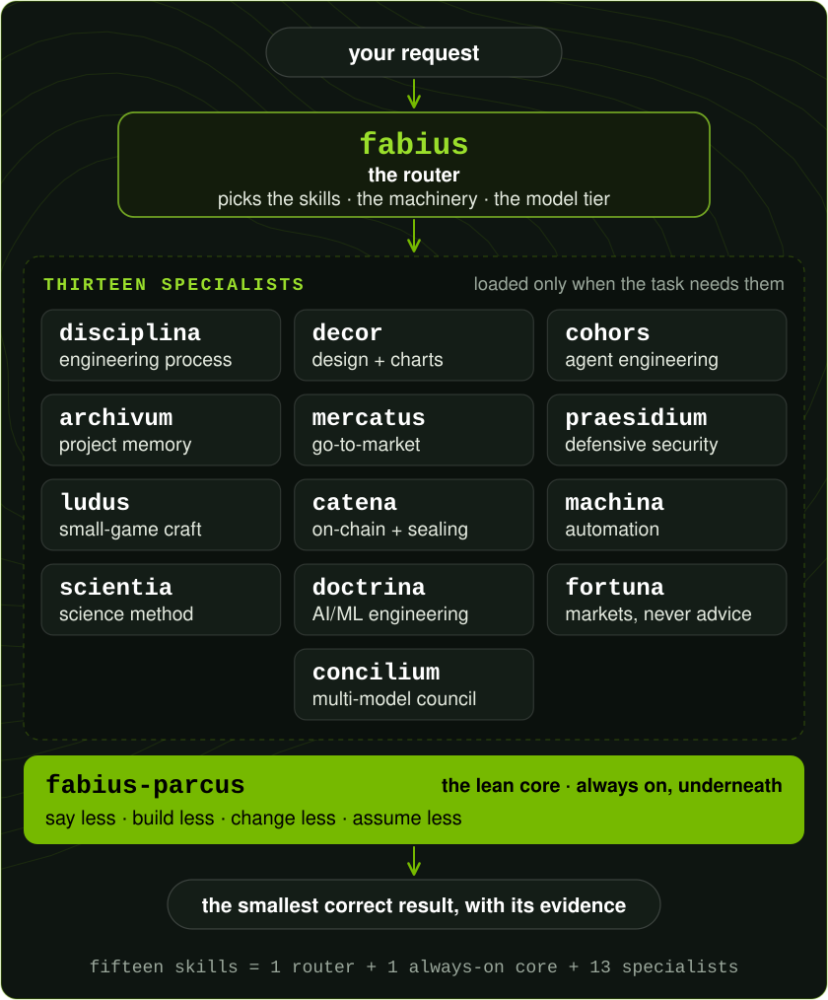

<div align="center">


#### scout wide · strike narrow

*one set of rules above every model*

<a href="#install-in-your-agent-app"></a>

</div>

## Put your skills to work together

A growing skill library creates a coordination problem: several skills cover the same concern, instructions pull in different directions, and a useful skill can remain unloaded when the task needs it.

Created by **Ariel Shemesh**, Fabius organizes fifteen skills into one method. A router identifies the work, selects the relevant owners and combines their responsibilities. You keep your agent app, your model and your tools.

**One set of rules, across LLMs and providers.** Fabius is model-agnostic: its working method is written for instruction-following LLMs, including open models. Bring your chosen model through an app that can load the instructions and expose the tools your task needs. The app-specific installation examples below are setup routes, not a model whitelist.

- **Select by the task.** Read the goal and project context, identify the domain, and decide whether the work needs memory, tools or a plan.
- **Compose with clear ownership.** Engineering owns the process, the domain owner defines its requirements, and the lean core runs underneath. Each rule has one home; other skills refer to it instead of competing copies.
- **Keep the result checkable.** Use the smallest sufficient tools, observe what they return, and verify the deliverable before calling it done. A missing capability stays visible.

The contracts guide the model; your agent app controls discovery, loading and execution. Automatic activation varies by app. Explicit invocation and the [Quickstart](QUICKSTART.md) help you check what actually loaded.

## Fifteen skills, coordinated

**Two layers hold the system together:**

- **`fabius` — the router.** Selects skill owners, the amount of machinery and the model tier appropriate to the task.
- **`fabius-parcus` — the lean core.** Keeps the work focused and the changes small while preserving validation, security, accessibility and data-loss handling.

**Thirteen specialists provide the methods:**

| Skill | What it brings to the task |
|---|---|
| `fabius-disciplina` | Engineering, architecture, debugging, plans and tests that cover the change |
| `fabius-decor` | Interfaces, design systems, charts, diagrams and visual media |
| `fabius-cohors` | Agent design, permissions, tool contracts and orchestration |
| `fabius-archivum` | Project records, retrieval and continuity across sessions |
| `fabius-mercatus` | Positioning, launch copy, funnels and SEO |
| `fabius-praesidium` | Defensive security, threat models and evidence-backed audits |
| `fabius-ludus` | Game loops, game feel and explicit state machines |
| `fabius-catena` | On-chain development, transaction safety and provenance sealing |
| `fabius-machina` | Deterministic automations, integrations and workflow verification |
| `fabius-scientia` | Scientific research, competing hypotheses and reproducible analysis |
| `fabius-doctrina` | Model training, serving, evaluation and monitoring |
| `fabius-fortuna` | Sourced market research, valuation and risk analysis |
| `fabius-concilium` | Independent model opinions, anonymized review and synthesis |



The distinction matters: Machina wires fixed workflow steps; Cohors designs agents. Scientia owns scientific analysis; Doctrina owns the model lifecycle. Mercatus sets the message; Decor gives it visual form. A task can use several of them without giving each the same job.

Each specialist includes linked references for deeper work. External services—such as a browser, market data, a GPU, n8n or an RPC endpoint—still need to be available and authorized in your app. When a capability is missing, the rules call for an equivalent that can produce the same evidence, or an explicit limit.

## One project, several skills

```text
Use Fabius to improve this product's signup page. Keep the existing brand,
clarify the message, fix the mobile form, and verify the result in a browser.
Explain which skills the task needs before editing.
```

The responsibilities fit together like this:

1. **Archivum** reads the project's existing record, if one is available, so decisions and constraints carry forward.
2. **Mercatus** clarifies the audience, message and next action. **Decor** handles the interface, mobile layout and focus states.
3. **Disciplina** plans the change, maps the affected behavior to checks and verifies the result. **Parcus** keeps every change tied to the request.

This is an example of the intended composition. The app must load the relevant contracts and expose the browser for the live check. If a specialist stays unloaded, invoke it explicitly; if the browser is unavailable, the result must say that live verification remains open.

For a small first task with a known answer, follow the [Quickstart](QUICKSTART.md). The [example collection](examples/README.md) includes supplied inputs, outputs and checks for data, code, meeting notes and a video brief. These are prepared demonstrations.

Explore the [four focused demos](https://fabius-landing.vercel.app/#trials): Math & visualization, Agent teams, Project memory and Clear code.

## Install in your agent app

Choose the setup mechanism your app supports. The model and the app are separate choices: a model follows the rules, while its app loads the files, supplies tools and controls permissions. The [compatibility record](COMPATIBILITY.md) reports specific host checks; it does not limit Fabius to those model families or establish identical behavior across every model.

**Other instruction-reading apps and model APIs**

The portable core is [AGENTS.md](AGENTS.md). Where separately authorized under the [licence](LICENSE), load it through your app's supported standing-instruction or system-prompt mechanism, preserving existing project rules. For the full fifteen-skill method, make the [router](skills/fabius/SKILL.md), [lean core](skills/fabius-parcus/SKILL.md) and relevant specialist contracts and references available. The portable core alone does not install the specialist library. Start a fresh task with “Use Fabius to…” and verify what actually loaded. Tool use and persistent memory depend on the app's capabilities and authorized storage.

The plugin managers below offer packaged setup routes:

**Claude Code**

```text
/plugin marketplace add shear559/fabius
/plugin install fabius@fabius
/reload-plugins
```

Start a request with `/fabius` for the router. To invoke a specialist directly, use its command, for example `/fabius:fabius-decor`.

**Codex** (restart Codex afterwards)

```text
codex plugin marketplace add shear559/fabius
codex plugin add fabius@fabius
codex plugin list --marketplace fabius
```

Name Fabius in a fresh task: “Use Fabius to…”. You can also name the specialist the task needs.

**Grok Build**

```text
grok plugin install shear559/fabius --trust
grok plugin enable fabius
```

Name Fabius or a specialist in the request. Check the [tested host behavior](COMPATIBILITY.md); installation and discovery alone do not establish model-task activation.

Confirm that your app lists Fabius as installed and exposes its skills in a fresh session. Update, disable, remove and troubleshooting instructions are in the [Quickstart](QUICKSTART.md).

## Help and boundaries

Fabius uses the tools and permissions your agent app grants. There is no Fabius server or account. Project-memory writes require authorization; live services and model access are yours to connect. Say `stop fabius` to stop applying its rules in the session; use your plugin manager to disable or uninstall it.

Fabius is publicly readable and proprietary. Personal, non-commercial installation through the marketplace command is free. Your model, services and compute have their own costs. Professional or client work needs permission: [LICENSE](LICENSE). [AGENTS.md](AGENTS.md) provides the portable core without the specialist library; use outside the marketplace grant also needs permission.

[Get help](SUPPORT.md) · [Verification checks](evals/README.md) · [Release provenance](PROVENANCE.md) · [How to verify](CHECKS.md)
